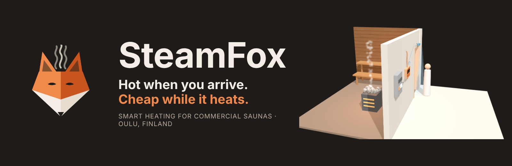
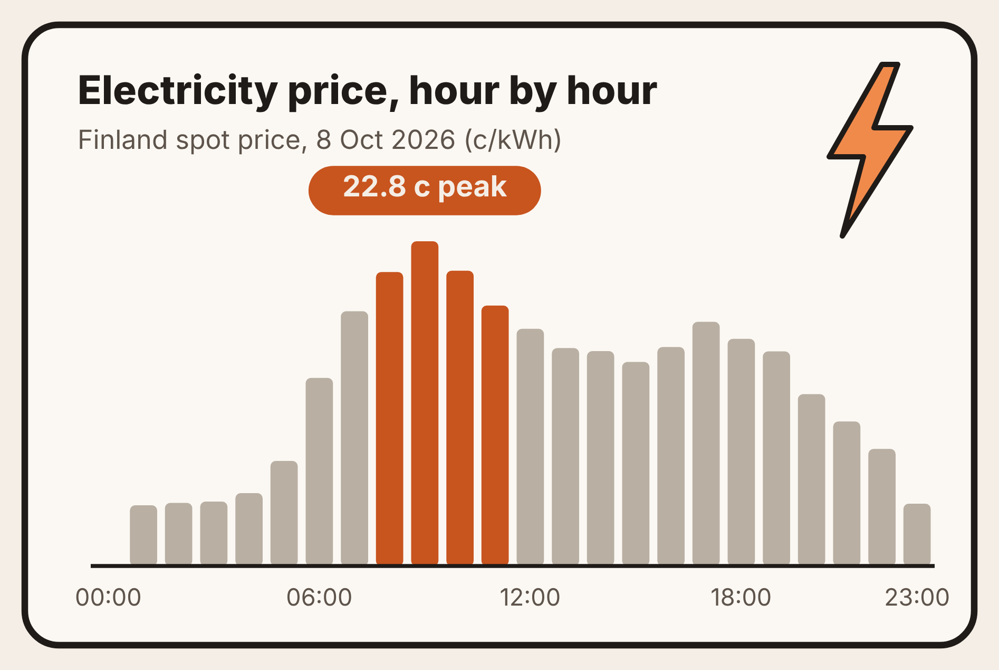
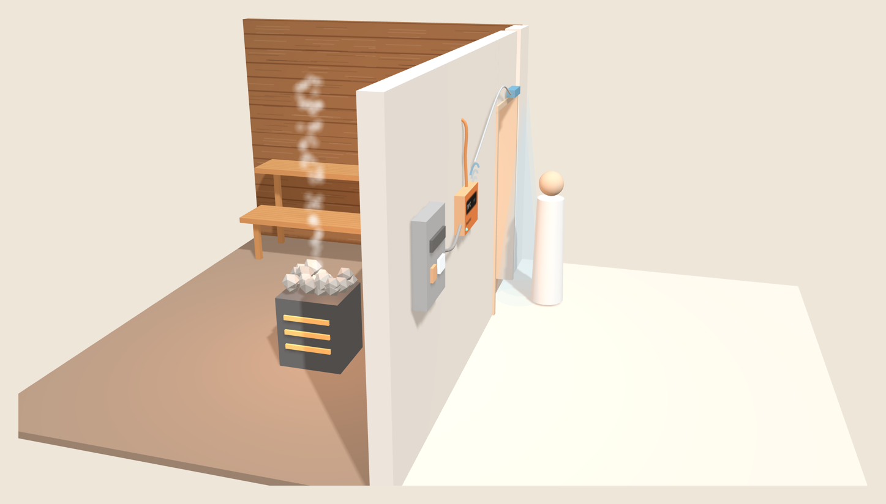
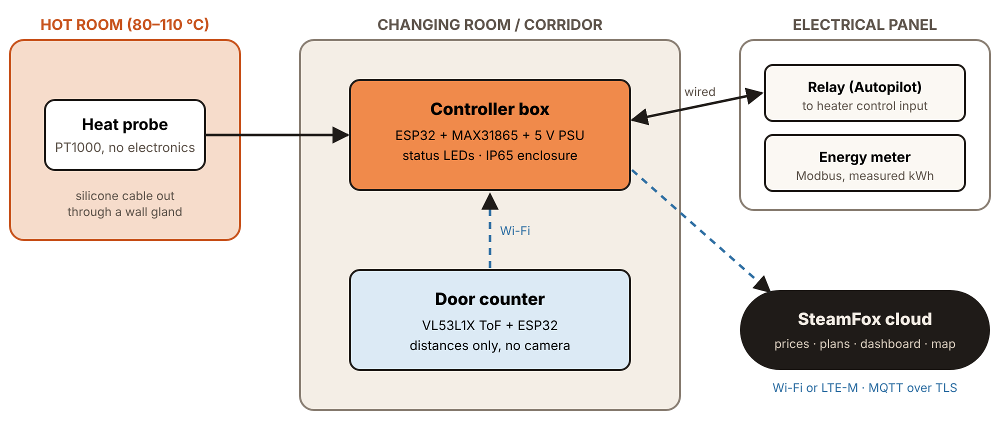
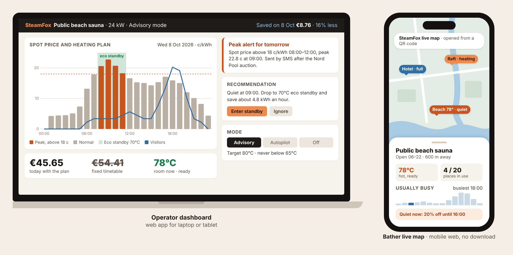
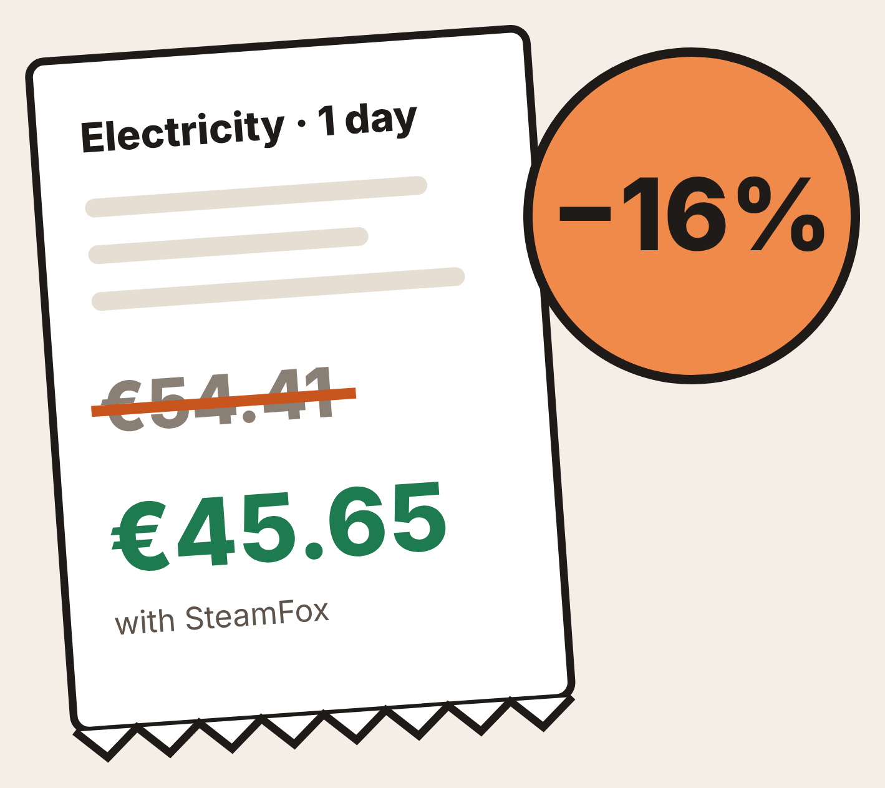
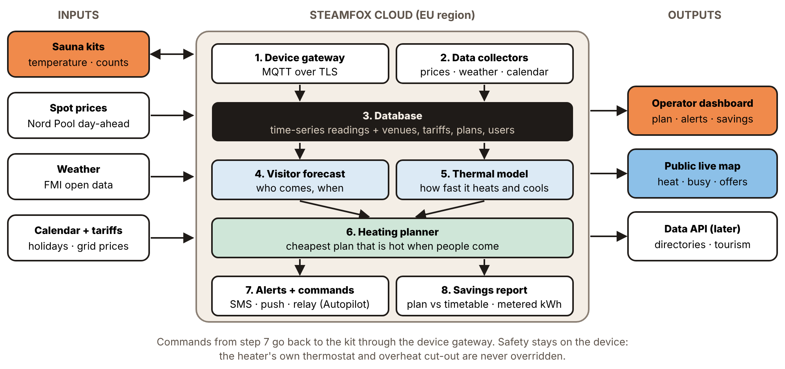

  

  <a href="https://ramisa13.github.io/SteamFox/"><b>🌐 Website</b></a> ·
  <a href="https://ramisa13.github.io/SteamFox/live.html"><b>⚡ Live savings</b></a> ·
  <a href="https://ramisa13.github.io/SteamFox/kit-3d.html"><b>🧊 3D kit</b></a> ·
  <a href="https://ramisa13.github.io/SteamFox/demo.html"><b>📊 Operator demo</b></a>

  
  
  
  

---

## 🔥 The problem

Finland has around three million saunas, and the commercial ones (public, hotel, rental and spa saunas) run electric heaters of **12–36 kW**, often for hours on a **fixed timetable**.

Meanwhile, Finnish spot electricity prices change **every 15 minutes** and spike hard in winter. So right now, somewhere in Finland, a sauna is heating itself beautifully for absolutely nobody, at the most expensive hour of the day.

Bathers have the opposite problem: they can't tell whether a sauna is **hot, full or empty** until they get there.

## 🦊 The solution

**SteamFox** is a small add-on kit for the heater a sauna already has, plus a cloud service that plans the heating.

1. **Measure.** A heat probe and a camera-free door counter report temperature and visitors.
2. **Plan.** SteamFox Cloud reads tomorrow's electricity prices and expected visitors, and plans the cheapest way to be hot on time.
3. **Act.** Owners get alerts and one-tap advice (Advisory), or let SteamFox run it (Autopilot). Bathers check a live map.

> **Warm up when power is cheap. Idle when it's quiet. Fully hot when people arrive.**

## 🧊 The kit in 3D

<a href="https://ramisa13.github.io/SteamFox/kit-3d.html"><b>👉 Rotate it yourself in the interactive 3D model</b></a>

| Part | Where | What it does |
|---|---|---|
| 🌡️ **Heat probe** | Hot room | PT1000 sensor high on the wall; the only part inside the heat |
| 🟧 **Controller box** | Changing room | ESP32 with Wi-Fi; reads the sensors and talks to the cloud |
| 🚪 **Door counter** | Above the door | Time-of-flight distance sensor; counts in and out, **no camera** |
| ⚡ **Relay + energy meter** | Electrical panel | Autopilot add-on, fitted by an electrician; measures real kWh |

**Safety first:** SteamFox never switches heater power directly and never bypasses the heater's own thermostat or overheat cut-out. If anything fails, the sauna falls back to its normal timetable.

## 📱 What people see

- **Operator dashboard:** tomorrow's plan on a price chart, peak-price alerts the day before, one-tap recommendations and the saving for the day.
- **Public live map:** bathers scan a QR code at the door and see how hot each sauna is and how busy it is. **No app to download.**

## 💶 The savings

We ran a 24 kW public sauna (open 06–22) through our model on **real Oulu spot prices**:

| Day | Fixed timetable | With SteamFox | Saved |
|---|---:|---:|---:|
| Thu 8 Oct 2026, price spike | €54.41 | €45.65 | **€8.76 (16%)** |
| Fri 9 Oct 2026, cheap flat day | €21.70 | €18.43 | **€3.27 (15%)** |

👉 **[See today's saving on live prices](https://ramisa13.github.io/SteamFox/live.html)**

That works out to roughly **€100–260 a month** per sauna, against a subscription of €19–39.

*Modelled savings: real spot prices, Oulun Energia tariff, example visitor pattern. The pilot will replace them with metered results.*

## ☁️ SteamFox Cloud

- **Visitor forecast:** learns when each sauna gets busy (weekday, hour, weather, holidays).
- **Thermal model:** learns how fast each sauna heats up and cools down.
- **Heating planner:** picks off / eco / full heat for every 15-minute slot to minimise cost while staying hot when people come.
- **Hosted in the EU**, MQTT over TLS, signed firmware, GDPR-ready.

## 🏆 Why SteamFox wins

| | Controls heater | Plans by spot price | Counts visitors, no camera | Live public map |
|---|:---:|:---:|:---:|:---:|
| Heater makers' apps | ✅ | – | – | – |
| Wireless sensors | – | – | – | – |
| DIY spot-price scripts | ✅ | ✅ | – | – |
| Sauna directories | – | – | – | static list |
| Booking systems | – | – | bookings only | – |
| **SteamFox** | ✅ | ✅ | ✅ | ✅ |

**Hardware-neutral** (works with the heater already installed) · **two-sided** (owners save, bathers see) · **privacy-first** (no cameras) · **data moat** (every season sharpens the forecasts).

## 💼 Business model

| Plan | Price | What you get |
|---|---|---|
| **Advisory** | **€19 / month** | Heating plan, peak alerts, live map. No wiring. |
| **Autopilot** | **€39 / month** | The same plan, run automatically through a relay. Pause any day. |
| **Kit** | **€199** | Free with a 12-month plan |
| **Bathers** | **Free** | Always |

**Later revenue:** live-data licences for sauna directories and tourism boards.

## 🚀 Roadmap

| When | Milestone |
|---|---|
| **Now** | Working software demo on real Nord Pool prices; sensor kit in build |
| **Winter 2026–27** | Advisory pilot in 2–3 Oulu saunas |
| **2027** | Autopilot with certified relay control and measured savings |
| **Then** | Tampere's sauna cluster, then Sweden and Estonia |

**Growth targets:** 15 saunas in 2027 → 120 in 2028 → 500 in 2029.

## 💰 The ask

We are raising **€15,000** in pre-seed funding to take SteamFox from demo to proven pilot by spring 2027: CE pre-testing, 20 sensor kits, relay installs, enclosure design, cloud tools and pilot marketing.

We are also looking for **pilot saunas in Oulu** and an **electrical partner**.

## 👥 Team

| | Role | Background |
|---|---|---|
| **Kazi Mehedi Hasan Joy** | Founder | BA English Language & Literature; NGO and INGO project work (USAID Protibesh Activity, British Council EDGE, Oxfam) |
| **Ramisa Fariha Mridha** | Hardware and sensors | MSc Biomedical Engineering, University of Oulu (highest distinction); BSc Electrical & Electronic Engineering |
| **Tahsin Shadman** | Data, IoT and analytics | MSc Business Analytics, University of Oulu; BSc Computer Science; MBA Supply Chain |

## 🗂️ This repository

| File | What it is |
|---|---|
| `index.html` | Landing page |
| `live.html` | Live savings: today's real electricity prices and the saving for an example sauna |
| `kit-3d.html` | Interactive 3D model of the kit (three.js) |
| `demo.html` | Operator dashboard demo on real Finnish spot prices |
| `data/prices.json` | Latest Finnish spot prices, refreshed daily by a GitHub Action |
| `scripts/fetch_prices.py`, `.github/workflows/prices.yml` | The daily price update |
| `assets/` | Images used in this README |

The site is plain HTML with no build step, published with GitHub Pages.

---

<b>SteamFox</b> · Hot when you arrive. Cheap while it heats. Built in Oulu for the Slush Oulu Pitching Competition 2026.

